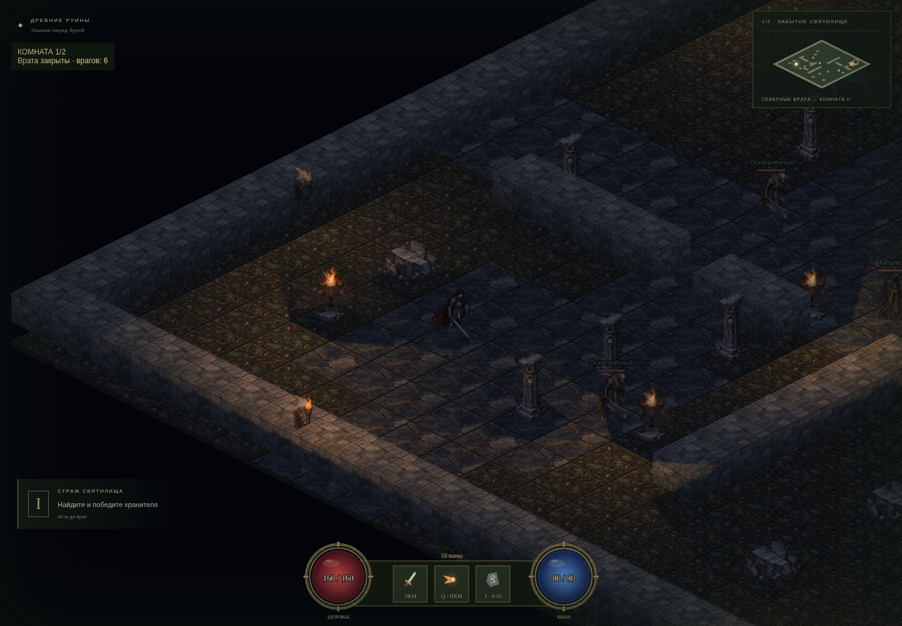

# Ashen Covenant

## Живописная переделка — локальный черновик 0.7.1

Новая графика Godot-эпизода: оригинальная готическая архитектура, персонажи и портреты, анатомические мутации, туман, мокрый камень и обновлённый интерфейс. [Посмотреть реальный игровой кадр](docs/art-direction/gameplay/exploration.png) · [Подробнее и запуск](godot/README.md). Черновик 0.7.1 пока не опубликован; ссылка ниже относится к предыдущему релизу 0.7.0.

## Godot 0.7.0 — Windows и Linux

Первый эпизод партийной пошаговой RPG находится в [`godot/`](godot/README.md): исследование Веля, диалоги и свидетельства, три героя, обращение, четыре личности и три исхода. Запуск: `godot --path godot`. [Скачать Godot-версию 0.7.0](https://github.com/chegrv166-alt/gpt2/releases/tag/v0.7.0): Windows — распаковать ZIP и запустить `.exe`; Linux — распаковать tar.gz и запустить `.x86_64`. Godot и Node.js игроку не нужны. Это ранний играбельный прототип; опубликованная 0.6 ниже остаётся отдельной версией на Phaser.

Браузерная изометрическая Action RPG: TypeScript strict, Phaser **3.90.0**, Vite.
Реализованы **все четыре шага** вертикального среза: нарисованные текстуры и процедурные эффекты, лесной коридор и две изометрические комнаты,
бой с двумя типами врагов и мини-боссом, лут, инвентарь, экипировка, сферы ресурсов и экраны завершения.



## Запуск

### Windows: скачать и открыть

Готовые Windows-файлы находятся в [Releases](https://github.com/chegrv166-alt/gpt2/releases/latest):

- `Ashen-Covenant-0.6.0-Windows-x64.exe` — переносная версия, запускается двойным щелчком.
- `Ashen-Covenant-0.6.0-Setup-x64.exe` — установщик с ярлыком на рабочем столе.

Для Windows 10/11 x64. Node.js, терминал и локальный сервер игроку не нужны. Движок и игра
включены в поставку; во время игры интернет не требуется. F11 переключает полный экран.
Сборки без цифровой подписи издателя. Прогресс текущего похода остаётся в памяти до закрытия игры.

### Разработка и браузерная версия

Нужен Node.js **22.12+**; среда разработки проверена на Node.js 24.19.0.

```sh
cd /workspace/gpt2
npm ci
npm run dev
```

Откройте адрес Vite, показанный в терминале. Для локального checkout используйте его фактический путь вместо `/workspace/gpt2`.
Главная страница открывает первый уровень — «Разбойничья тропа», лесной коридор **92×23 клетки**.
Двенадцать разбойников встречают героя группами: быстрые бойцы с ножами, копейщики с длинным выпадом
и лучники, стреляющие физическими стрелами и отступающие при сближении. Деревья блокируют движение,
свет и снаряды. После полной зачистки выход на востоке ведёт в «Забытое святилище» (уровень 2),
затем в «Зал погребального огня» (уровень 3). Обе прежние карты и их противники сохранены.

Экипировка, рюкзак, HP и мана переносятся между всеми тремя уровнями. Возрождение сохраняет вещи
и возвращает ко входу текущего уровня; R начинает новый поход в лесу. Миникарта масштабируется под
размер уровня. В лесу — мягкий зелёный дневной свет и костры, в подземельях — прежние факелы и тени.
Все лесные текстуры и анимации разбойников создаются локально средствами Phaser; внешние ассеты не загружаются.

Для регрессионной разработки Vite поддерживает `/?room=2` и `/?room=3`; в production и Electron
поход всегда начинается в лесу. Этот выбор не изменяет действие R.

Главная страница открывает арену. Ссылка **«Кузница ассетов»** (`/?view=forge`) сохраняет весь просмотр Шага 1:
четыре персонажа, четыре состояния, восемь направлений, масштаб, пауза и категории текстур.

### Управление

| Ввод | Действие |
| --- | --- |
| ЛКМ по земле / касание | Выбрать точку и пройти к ней, обходя препятствия |
| ЛКМ / касание по врагу | Сблизиться и автоматически атаковать выбранную цель |
| Shift+ЛКМ | Ударить сектором в направлении указателя, оставаясь на месте |
| Q / ПКМ / кнопка умения | Выпустить взрывной снаряд в сторону указателя |
| WASD / стрелки | Двигаться относительно экрана; отменяет выбранный маршрут |
| Esc | Отменить движение, цель и текущее действие |
| M / кнопка «Карта» | Показать или скрыть мини-карту |
| I / кнопка «Рюкзак» / слот с руной | Открыть инвентарь и приостановить бой; I / Esc закрывает окно |
| ЛКМ / касание по выпавшему предмету | Подойти и подобрать; вещи рядом подбираются автоматически |
| E рядом с открытыми вратами / клик по ним | Перейти во вторую комнату после полной зачистки первой |
| R / кнопка «К началу» | Начать новый поход: очистить вещи, лут и снаряжение, восстановить HP, ману и врагов |
| Enter на экране смерти / победы | Возродиться с сохранением вещей / продолжить исследование |
| Кнопки − / + | Изменить масштаб, сохранив правильное определение точки клика |

Зачистите лесную тропу, затем найдите проход к северным вратам подземелья и победите Пепельного стража. Метки на мини-карте показывают противников,
и наземный лут, а панель цели — расстояние. Сферы HP/маны и хотбар находятся в отдельной Phaser UI Scene.
При гибели нажмите «Возродиться» или Enter: инвентарь и экипировка сохранятся, герой и противники
восстановятся, старый лут на земле исчезнет. После победы «Забрать награду» возвращает в мир:
подберите легендарный предмет у босса. После победы над **всеми шестью противниками святилища (уровень 2)**
северные врата открываются: нажмите E рядом с ними или кликните по кольцу врат.
Третий уровень — «Зал погребального огня» — имеет собственные стены, препятствия и шесть врагов с боссом.
При переходе HP, мана, рюкзак и экипировка сохраняются; несобранный лут остаётся на предыдущем уровне,
обратного перехода нет. Возрождение возвращает к входу **текущей** комнаты.
R / «Новый поход» сбрасывает весь прогресс и возвращает в лес.
При потере фокуса окна движение останавливается, зажатые клавиши сбрасываются.

```sh
npm run typecheck
npm run build
npm run preview
```

Зависимости устанавливаются из npm с проверкой integrity из `package-lock.json`.
`ignore-scripts` для обычной установки не требуется: esbuild использует свой стандартный установочный сценарий.
После установки игра не обращается к внешним URL. Три нарисованных PNG-атласа включены в приложение;
эффекты и остальные текстуры создаются локально. Загрузка шрифтов или API не требуется.
Supabase, токены GitHub и переменные окружения для игры не нужны. Прогресс хранится в памяти текущей вкладки.
Vite сообщает о крупном JS-чанке: в него входит сам движок Phaser; сборка при этом завершается успешно.

### Сборка настольной версии из исходников

```sh
npm ci
npm run desktop
npm run dist:win
```

`dist:win` создаёт переносной `.exe` и установщик в `release/`. Надёжнее собирать под Windows;
публикация тега `v*` запускает [Windows executable](https://github.com/chegrv166-alt/gpt2/actions/workflows/windows-release.yml):
сборка, тест настоящего `win-unpacked/Ashen Covenant.exe`, загрузка файлов в GitHub Release.
`npm run test:desktop` проверяет встроенную игру через Electron без Vite-сервера.
Отдельный процесс Electron компилируется TypeScript strict из `desktop/main.cts`; привилегии Node.js
в игровом окне отключены. Vite выдаёт относительные пути для запуска со встроенного диска.

## Структура и границы модулей

```text
src/
  assets/catalog.ts             Типы, размеры, ключи текстур, направления, определения персонажей
  assets/PaintedTextures.ts     Локальные атласы, выделение силуэтов и подготовка текстур
  assets/art/                   Нарисованные материалы, предметы окружения и персонажи
  scenes/BootScene.ts           Graphics → generateTexture → TextureManager; регистрация анимаций
  scenes/AssetGalleryScene.ts   Предпросмотр созданных текстур без игровой логики
  scenes/GameScene.ts           Соединяет ввод, игрока, мир и камеру
  scenes/MapScene.ts            Мини-карта с собственной экранной камерой
  scenes/UIScene.ts             Сферы, хотбар, модальные окна; независимая камера и ввод
  math/isometric.ts            Обратимая проекция 2:1 и экранные направления
  world/ArenaLayout.ts         Две арены 23×23: пол, препятствия, вход и врата
  world/rooms.ts               Названия комнат и отдельные расстановки противников
  world/CollisionGrid.ts       Круг/прямоугольники и точные swept-проверки отрезков
  world/pathfinding.ts         A* на восьми соседях и безопасное сглаживание пути
  world/ArenaRenderer.ts       Отрисовка мира и прозрачность перекрывающих героя объектов
  world/FloorLayer.ts          Четыре кэшированных слоя неподвижного пола
  lighting/lighting.ts         Источники света, затухание и геометрия теней
  lighting/RoomLighting.ts     Карта света с холодным окружением и мерцанием факелов
  entities/PlayerMotor.ts      Движение и маршрут в координатах земли, без Phaser
  entities/Player.ts           Модель движения + спрайт, анимации, сортировка по глубине
  entities/Enemy.ts            FSM обычных врагов и босса; модель без Phaser
  entities/DropItem.ts         Наземный предмет в координатах земли, без Phaser
  components/StatsComponent.ts Базовые/производные статы, HP, мана и модификаторы
  components/InventoryComponent.ts  10 слотов, атомарные операции экипировки и пересчёт статов
  items/definitions.ts         Редкости, неизменяемые предметы, иконки и описания бонусов
  loot/LootSystem.ts           Уникальные награды за убийства, дистанция/видимость подбора
  combat/definitions.ts        Баланс, типы врагов, спавны и типизированные события
  combat/geometry.ts           Сектор ближнего боя, броня, криты, пересечение снарядов
  combat/HeroCombat.ts         Действия героя, задержки удара и перезарядки
  combat/ProjectileSystem.ts   Непрерывные столкновения снарядов с телами и стенами
  combat/CombatWorld.ts        Последовательность расчёта боя и события попаданий/смерти
  views/EnemyView.ts           Спрайты, имена, HP и телеграфируемая зона
  views/CombatView.ts          Представление снарядов, ударов и взрывов
  views/FloatingCombatText.ts  Числа урона с выделением критов
  views/LootView.ts            Иконки, лучи редкостей, подписи и определение клика по луту
  systems/AdventureSystem.ts   Прогресс, модальная пауза, смерть, победа и сброс похода
  systems/PlayerInput.ts       Клавиатура, указатель, фокус и очистка обработчиков
  systems/TargetIndicator.ts   Кольцо назначения и пунктир маршрута
  ui/ForgeUI.ts                DOM-инспектор: выбор ассета и параметры предпросмотра
  ui/ExpeditionUI.ts           Управление игровым экраном через события
  ui/OrbView.ts                Сферы с заполнением по текущему ресурсу из кэша BootScene
  ui/InventoryPanel.ts         Рюкзак, экипировка, свойства и характеристики; мобильная раскладка
  ui/EndOverlay.ts             Экраны смерти/победы и команды продолжения
  ui/widgets.ts               Векторные панели, кнопки и подписи Phaser
  main.ts                      Конфигурация Phaser и соединение сцены с инспектором
  style.css                    Адаптивная оболочка без внешних шрифтов и изображений
  expedition.css              Оформление игрового экрана
  combat.css                  Полосы ресурсов и доступные мыши/касанию способности
tests/boot.spec.ts              Интеграционные проверки в настоящем браузере
tests/game.spec.ts              Клавиатура, мышь, настоящий touch, камера и жизненный цикл
tests/world.spec.ts             Проекция, коллизии, маршруты, скорость и проходимость арены
tests/combat.spec.ts            Чистые проверки характеристик, попаданий, снарядов и FSM
tests/combat-game.spec.ts       Бой настоящим вводом, ресурсы, перезарядка и предупреждение босса
tests/loot.spec.ts              Владение вещами, переполнение, модификаторы, подбор и исходы похода
tests/loot-game.spec.ts         Настоящее убийство, выпадение, подбор, экипировка и пауза
tests/ui.spec.ts                Сферы, окна, респавн, победа, выкладывание, мобильный экран и перезапуск
```

`BootScene` не зависит от UI. В `preload()` он загружает три включённых PNG-атласа и создаёт процедурные
текстуры через временный `Graphics`. В `create()` `PaintedTextures` проецирует нарисованные материалы
на изометрические поверхности и подготавливает кадры персонажей с сохранением ключей и точек опоры.
Затем сцена проверяет полноту кэша и размеры, регистрирует анимации и запускает `GameScene`
либо `AssetGalleryScene`, в зависимости от режима, выбранного в `main.ts`.
Генераторы эффектов используют фиксированные seed: повторный чистый запуск создаёт одинаковую графику.
Повторный вход в `BootScene` сохраняет существующие экземпляры текстур и анимаций.

## Координаты, перемещение и столкновения

Позиция героя — непрерывная пара `(x, y)` в плоскости земли. Центр клетки имеет целые координаты;
границы клетки — `x ± 0.5`, `y ± 0.5`. Экранные пиксели не используются как координаты физики.

```text
screenX = originX + (x - y) * 64
screenY = originY + (x + y) * 32

x = ((screenX - originX) / 64 + (screenY - originY) / 32) / 2
y = ((screenY - originY) / 32 - (screenX - originX) / 64) / 2
```

- Скорость героя: 3.4 клетки/секунду; радиус коллизии: 0.22 клетки.
- Экранный вектор WASD преобразуется в вектор земли и нормализуется. Диагонали не ускоряют героя;
  изометрическое сокращение по вертикали сохраняется.
- Ввод использует `KeyboardEvent.code`, поэтому WASD не зависит от раскладки клавиатуры.
- Клик переводится из координат canvas через `camera.getWorldPoint()` и затем `screenToIso()`.
- A* запрещает проход сквозь диагонально соприкасающиеся препятствия. Сглаживание пути
  использует точное расстояние от отрезка до прямоугольника с учётом радиуса героя.
- Движение разбивается на шаги не более 1/60 секунды и пространственные подшаги; swept-проверки
  предотвращают проникновение в стены. При ручном движении вдоль стены герой скользит по свободной оси.
- Сглаживание времени Phaser отключено; симуляция учитывает реальное время кадра (с пределом 250 мс
  для длинных зависаний), а не замедляется из-за повторения старой дельты при низком FPS.
- Камера использует `startFollow`, экспоненциальное сглаживание с учётом времени кадра и границы мира.
  Мини-карта находится в отдельной сцене и не масштабируется вместе с миром.
- Спрайт и объекты сортируются по экранной координате ног. Перекрывающие героя высокие объекты
  становятся полупрозрачными; их коллизии сохраняются.

## Бой и ИИ

В арене три бойца ближнего боя, два культиста и один мини-босс. Позиции и характеристики
настраиваются в `combat/definitions.ts`. Кузница остаётся изолированным просмотром ассетов и не запускает бой.

| Характеристика героя | Значение |
| --- | ---: |
| HP / мана | 160 / 80 |
| Урон / броня | 26 / 15 |
| Скорость | 3.4 клетки/с |
| Шанс / множитель крита | 12% / 1.8 |

Расчёт попадания: `max(1, round(attackDamage * power * criticalMultiplier * 100 / (100 + armor)))`.
При обычном попадании `criticalMultiplier` равен 1. Модификаторы суммируются в `StatsComponent`;
изменение максимума ресурса ограничивает текущее значение, но не лечит автоматически.

- Ближний удар имеет дальность 1.2 клетки, сектор 110°, задержку 0.14 с и перезарядку 0.52 с.
  Учитывается радиус тела цели и прямая видимость: сквозь стены ударить нельзя. Один взмах наносит
  урон каждой подходящей цели один раз. Движение блокируется только на время короткого действия.
- Пепельный импульс стоит 18 маны, восстанавливается 1.4 с, наносит 1.9 базового урона
  и взрывается в радиусе 1.25 клетки. Снаряд летит со скоростью 7.5 клетки/с до 1.35 с.
  Система выбирает первое столкновение со стеной или противником, даже если снаряд пересёк цель за кадр.
  Взрыв задевает несколько врагов, но не проходит через стены. Умение нельзя повторить во время
  действия, перезарядки, без маны или после смерти.
- Мана восстанавливается по 6/с; HP — по 3/с после шести секунд без получения урона.
  После попадания герой получает 0.18 с защиты от одновременных повторных попаданий.
- FSM врага: `IDLE → CHASE → ATTACK`, попадание переводит в `HURT`, истощение HP — в терминальный `DEAD`.
  Во время атаки враги останавливаются, а урон появляется после windup, а не в момент выбора цели.
- Боец преследует героя по A*. Культист отходит при сближении, держит дистанцию и выпускает снаряды.
- Босс имеет 320 HP и специальный удар: круг радиусом 1.7 клетки фиксируется на позиции героя,
  затем срабатывает через 1.05 с. Выход из круга позволяет уклониться. Уже начатый каст босса
  не прерывается обычным hit-stun; убийство босса отменяет удар.
- Тела живых персонажей мягко разделяются с сохранением статических коллизий. Мёртвые враги
  не блокируют проход, не атакуют и плавно исчезают. R удаляет снаряды и временные эффекты,
  восстанавливает ресурсы и создаёт начальный набор врагов заново.
- `CombatWorld` и модели не зависят от Phaser. Представление потребляет события урона, взмахов,
  взрывов и смерти; события смерти подключены к `LootSystem`.

## Лут, снаряжение и завершение похода

Каждый погибший враг оставляет один предмет. Common отмечен серым лучом, Rare — синим,
Legendary — золотым. Обычные противники дают случайную редкость и тип предмета; босс гарантирует
легендарное оружие. Повторная доставка одного события смерти не создаёт дополнительную награду.

Подбор работает по клику с прокладкой маршрута либо автоматически в радиусе **0.85 клетки**
при прямой видимости. Сквозь стену или после смерти подобрать вещь нельзя. Если все 10 слотов заняты,
предмет остаётся на земле; наденьте вещь либо выберите её в рюкзаке и нажмите «На землю».
Выложенный предмет появляется в свободном месте за радиусом автоподбора.

В окне I выберите ячейку и нажмите «Надеть». Старое снаряжение вернётся в ту же ячейку,
даже если рюкзак полон. Выберите слот оружия/доспеха и «Снять», чтобы вернуть вещь в свободную ячейку.
Если свободной ячейки нет, снаряжение остаётся надетым. Пересчёт бонусов не лечит героя;
уменьшение максимума HP/маны ограничивает текущий ресурс новым максимумом.

| Бонус | Common | Rare | Legendary |
| --- | ---: | ---: | ---: |
| Оружие: урон | +6 | +13 | +24 |
| Оружие: дополнительные бонусы | — | — | +8% крита, +12 маны |
| Доспех: броня / HP | +5 / +8 | +12 / +16 | +22 / +32 |
| Доспех: скорость | — | +0.15 | +0.3 |

Открытый инвентарь, смерть и экран победы приостанавливают боевую симуляцию. Ввод по интерфейсу
не проходит в арену; камера UI не зависит от масштаба мира. Победа показывается один раз за встречу,
одновременная гибель героя имеет приоритет. Продолжение после победы сохраняет награду на земле.
На узком экране инвентарь перестраивается в компактную раскладку.

## Контракт текстур для следующих шагов

Все 1053 текстуры основного каталога имеют прозрачный фон. Окружение и персонажи подготовлены
из трёх локальных PNG-атласов в `src/assets/art/`; дополнительные текстуры обслуживают вторую комнату
и настенные светильники. [Художественное направление и происхождение ассетов](docs/art-direction.md).

Обновление 0.5.0 добавляет шесть нарисованных кадров ходьбы для героя, обычных врагов и босса.
Попадания оставляют кровавые брызги и пятна; погибшие враги остаются на полу рядом с лужами до выхода
из комнаты. Персонажи оставляют временные следы, проходя по крови. Контент рассчитан на аудиторию 18+.

В комнатах действует карта освещения: холодный окружающий свет и затухающие янтарные источники
от напольных жаровен и настенных факелов. Стены, колонны и крупные препятствия перекрывают свет.
Маски теней кэшируются; мерцание обновляется с частотой 12 Гц. Предупреждение босса и UI остаются читаемыми.

| Группа | Ключи | Число | Размер |
| --- | --- | ---: | --- |
| Земля, камень | `tile-ground-0`–`3`, `tile-stone-0`–`3` | 8 | 128×80 |
| Лес, тропа | `tile-forest-0`–`3`, `tile-path-0`–`3` | 8 | 128×80 |
| Дерево | `prop-tree` | 1 | 128×144 |
| Стены | `wall-nw`, `wall-ne` | 2 | 128×144 |
| Объекты | `prop-rock`, `prop-pillar`, `prop-brazier` | 3 | 128×144 |
| Персонажи | `{actor}-{state}-{direction}-{frame}` | 1008 | 128×112; босс 160×144 |
| Снаряды | `projectile-ember`, `projectile-arcane`, `projectile-slash`, `projectile-arrow` | 4 | 64×64 |
| Предметы | `icon-sword`, `icon-armor`, `icon-potion-health`, `icon-potion-mana`, `icon-ring`, `icon-rune` | 6 | 48×48 |
| Эффекты | Включая `fx-blood-spray`, `fx-blood-pool`, `fx-blood-footprint` | 10 | См. `EFFECT_SPECS` |
| Сферы интерфейса | `ui-orb-frame`, `ui-orb-health`, `ui-orb-mana` | 3 | 160×160; жидкости 128×128 |

- `actor`: `hero`, `grunt`, `caster`, `boss`, `knife`, `spear`, `archer`.
- `state`: `idle`, `walk`, `attack`, `hurt`.
- `direction`: `e`, `se`, `s`, `sw`, `w`, `nw`, `n`, `ne`; порядок по часовой стрелке.
- `frame`: 0–5 для `walk`, 0–3 для остальных состояний.
- Используйте `actorTextureKey()` и `actorAnimationKey()`, чтобы не собирать строки вручную.
- 224 направленные анимации: `idle` 4 fps, `walk` 9 fps (6 кадров), `attack`/`hurt` 12 fps (4 кадра).
  `idle`/`walk` циклические; `attack`/`hurt` однократные. Только предпросмотр явно переопределяет их `repeat: -1`.
- Опорная точка персонажа: `setOrigin(0.5, ACTORS[id].footY / ACTORS[id].height)`.
  Размеры и опорная точка одинаковы для всех кадров одного персонажа.
- Верхняя плоскость тайла имеет ромб 128×64; холст 128×80 включает толщину.
  Центр пола `(64, 34)` → `setOrigin(0.5, 34 / 80)`.
- Предметы отображаются отдельным `LootView`; лучи Common/Rare/Legendary окрашены в серый, синий и золотистый.
- `fx-telegraph` — прозрачный красный эллипс для зоны атаки на изометрической плоскости.
  Его экранный размер рассчитывается из физического радиуса с учётом проекции.
- `BloodField` хранит трупы, лужи и следы только до выгрузки комнаты; следы и всплески плавно исчезают.

## Браузерные проверки

```sh
npx playwright install chromium
npm test
```

Если Chromium уже установлен в системе, скачивание не нужно:

```sh
CHROMIUM_PATH=/usr/bin/chromium npm test
```

Playwright запускает и останавливает Vite на порту 5173 или использует уже работающий сервер.
Проверки читают реальные пиксели всех текстур, выявляют пустые/пропавшие изображения,
проверяют размеры, прозрачность, отсутствие обрезанных краями кадров персонажей, разнообразие кадров и отсутствие внешних запросов.
Также проверяются анимация выбранного персонажа в Phaser, пауза и продолжение с того же кадра, сохранение кэша при повторном входе,
категории каталога и доступность управления на экране шириной 390 px.
Проверки Шага 2 дополнительно упражняют WASD, отмену маршрута, прибытие в точку за стеной,
отказ от непроходимой цели, настоящий touch, масштабирование, камеру, возврат ко входу,
потерю фокуса и освобождение обработчиков при уничтожении игры.
Чистые тесты проверяют обратимость проекции, восемь направлений, геометрию столкновений,
запрет срезать углы и одинаковую скорость при 5, 30 и 60 обновлениях в секунду.
Боевые проверки подтверждают броню/криты, расходы маны и пересчёт модификаторов, сектор и видимость,
первое столкновение снаряда, AoE по нескольким целям, отсутствие урона сквозь стену, переходы FSM,
отступление культиста, задержку и возможность уклониться от удара босса.
Браузерные проверки нажимают Q/ПКМ, выбирают врага для автосближения и удара, выполняют Shift+ЛКМ,
проверяют ресурсы/перезарядку и фактически отображаемый круг перед ударом мини-босса.
Проверки Шага 4 упражняют полный рюкзак и замену экипировки, отсутствие дубликатов/накопления статов,
подбор сквозь стены/после смерти, фактическое заполнение сфер, паузу и блокировку ввода,
реальное убийство с подбором, надевание/выкладывание, смерть/респавн, победу/продолжение,
мобильный инвентарь и повторный запуск сцены без дублирования обработчиков.
Проверки комнат подтверждают блокировку врат до полной зачистки, переход по E и клику с обходом стен,
сохранение вещей и HP, уникальные награды во второй комнате, возрождение в текущем зале
и возврат к первой комнате при новом походе.
Графические проверки читают действующую карту света, проверяют тени и затухание, сохранность
силуэтов в исходном атласе и освобождение световых карт и слоёв пола при перезапуске.

Работа ведётся в существующем изолированном checkout; отдельный Git worktree не требуется.

Новые проверки `tests/forest.spec.ts` и `tests/forest-game.spec.ts` покрывают размер и связность леса,
все три вида оружия, блокировку стрел деревьями, масштаб миникарты, переходы 1→2→3,
перенос экипировки, возрождение и сброс похода.
