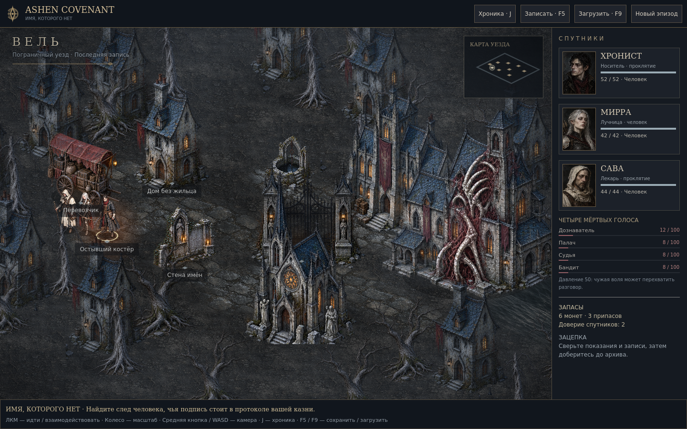

## Ashen Covenant 0.7.1 — «Имя, которого нет»

Полная живописная переделка партийной RPG на **Godot**.

### Windows 10/11 x64

Скачайте **Ashen-Covenant-0.7.1-Windows-x64.zip**, распакуйте и откройте **Ashen-Covenant-Chronicle.exe**. Установка Godot, Node.js и подключение к интернету для игры не нужны. Для графики требуется поддержка OpenGL 3.3.

### Linux x86_64

Распакуйте **Ashen-Covenant-0.7.1-Linux-x86_64.tar.gz** и запустите `./Ashen-Covenant-Chronicle.x86_64`. Архив сохраняет право на выполнение.

### Что изменилось

- Оригинальная готическая архитектура всех девяти мест, подробные деревья и каменные обломки.
- Новые фигуры героев, противников и узницы; четыре отдельные анатомические формы обращения.
- Двенадцать портретов: спутники, все четыре голоса и основные собеседники.
- Холодный грунт, мокрая мостовая, живая вода, мягкий туман, пепел и локальные огни.
- Единый интерфейс из тёмного железа, кости и старой латуни; диалоги с портретами.
- Компактная раскладка 960×640 с видимыми очередью и намерениями врагов, точный выбор непрозрачных силуэтов.
- Сюжет, тактические правила и формат сохранений сохранены; узница со старым обозначением изображения получает собственный облик.

ЛКМ — движение/взаимодействие; WASD — камера; колесо — масштаб; J — хроника; F5/F9 — сохранить/загрузить. В бою: 1–5 — действия, E — механизм, Tab — голос, Пробел — завершить активацию. Подробности находятся в README-RU.txt внутри архива.

Это ранний прототип. Анимация пока процедурная, без полного набора направленных покадровых циклов. Содержит мрачные темы и текстовые упоминания насилия, 18+.

Перед публикацией GitHub Actions выполняет 235 проверок модели, ресурсов, интерфейса и прохождения на Windows и Linux, собирает нативные приложения и проверяет запуск экспортированных файлов без графики на соответствующей ОС. Отрисовка дополнительно проверена на Linux с настоящим OpenGL-контекстом, включая экспортированную сборку. Контрольные суммы архивов находятся в SHA256SUMS.txt.
